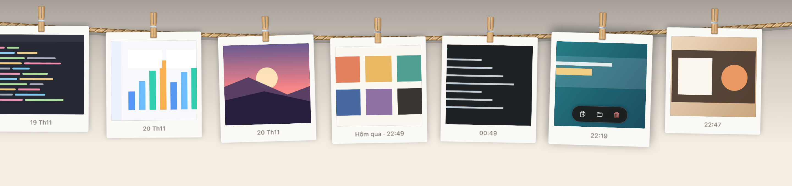

<p align="center">
  
</p>

<h1 align="center">SnapLine</h1>

<p align="center">
  <strong>A tactile, 120fps native macOS clothesline overlay for your screenshots & screen recordings.</strong><br/>
  <sub>Ứng dụng macOS siêu nhẹ treo lịch sử ảnh chụp & quay màn hình lên sợi dây thừng Polaroid ở 1/4 trên màn hình.</sub>
</p>

<p align="center">
  <a href="https://sotacom.github.io/SnapLine/"></a>
  <a href="https://github.com/sotacom/SnapLine/releases/latest"></a>
  
  
  <a href="LICENSE"></a>
</p>

<p align="center">
  
</p>

---

## What is SnapLine? / SnapLine là gì?

**English:** Whenever you take a screenshot or finish a screen recording on macOS, **SnapLine** drops a braided jute clothesline across the top quarter of your display. Your entire screenshot history hangs chronologically as warm Polaroids clipped with wooden clothespins — newest on the right, older on the left. Existing cards sway gently in a light breeze and slide left to make room as your latest capture arcs up from the bottom-right and snaps onto the rope.

**Tiếng Việt:** Mỗi khi bạn chụp màn hình hoặc quay màn hình xong, **SnapLine** hạ một sợi dây thừng bện tự nhiên ở vùng 1/4 phía trên màn hình, treo toàn bộ lịch sử ảnh chụp theo thứ tự thời gian (cũ bên trái → mới nhất bên phải). Các ảnh cũ rung rinh nhẹ và trượt sang trái nhường chỗ cho bức ảnh mới bay vút lên kẹp gỗ trên dây.

---

## Highlights

- **4-Stage Physics Choreography:** Gentle breeze reveal → smooth left shift → parabolic Bezier fly-in from bottom-right → wooden clothespin snap with elastic catenary rope ripple and sympathetic neighbor sway.
- **60 / 120fps ProMotion with ~0% Idle CPU:** Built purely on `AppKit`, `QuartzCore` (`CALayer`), and demand-driven `CADisplayLink` that automatically pauses when all pendulums and waves settle.
- **1:1 Trackpad & Smooth Wheel Timeline:** Swipe horizontally with two fingers (or scroll wheel) back through hundreds or thousands of captures. An $O(1)$ virtualization window mounts only visible cards + a 2-card buffer and prefetches thumbnails ahead of scroll.
- **Rich Per-Card Actions:**
  - **Drag & Drop** any Polaroid straight into Slack, Figma, Chrome, Mail, or Finder.
  - **Click** to open native **Quick Look** (`QLPreviewPanel`); **Double-click** to open in the default app.
  - **Hover** to lift the card, reveal a frosted pill with **Copy** (image + file URL), **Reveal in Finder**, and **Move to Trash** (unclip & drop), plus **inline muted video preview** for `.mov` / `.mp4` screen recordings.
- **Customizable Folder & Instant Capture:** Automatically detects your `com.apple.screencapture` folder, lets you pick any custom directory (with optional macOS location sync), and offers a 1-click toggle to disable macOS's 5-second floating thumbnail delay when saving to internal storage.
- **100% Local & Private:** Zero network calls, zero telemetry, zero Electron/WebView overhead (~1.1 MB executable).

---

## Install / Cài đặt

### Option 1: Download Prebuilt App (Recommended)

1. Download **`SnapLine-1.0.1-macos-arm64.dmg`** (or `.zip`) from the [Latest Release](https://github.com/sotacom/SnapLine/releases/latest).
2. Open the `.dmg` and drag **SnapLine.app** into **Applications**.
3. **First-launch Gatekeeper note:** SnapLine is open-source and ad-hoc code-signed (not Apple-notarized). Before first launch, run:
   ```bash
   xattr -cr /Applications/SnapLine.app
   ```
   *(Or right-click `SnapLine.app` → **Open** → confirm via **System Settings → Privacy & Security → Open Anyway**).*

### Option 2: Build from Source (No Xcode Required)

Requires macOS 14+ with Apple Swift Command Line Tools (`xcode-select --install`).

```bash
git clone https://github.com/sotacom/SnapLine.git
cd SnapLine

# Run all 12 unit tests
swift run SnapLineTestSuite

# Build & ad-hoc sign build/SnapLine.app
./scripts/build_app.sh

# Optional: Package .dmg + .zip + SHA256SUMS.txt into dist/
./scripts/package_release.sh 1.0.1
```

---

## Controls & Shortcuts

| Action | Shortcut / Gesture |
|---|---|
| Toggle clothesline overlay | `⌘⇧L` (customizable) or Menu Bar icon |
| Browse history (older ← / → newer) | Two-finger Trackpad swipe, Mouse wheel, or `←` / `→` |
| Quick Look full-resolution preview / video | Single-click card or `Space` |
| Open in default app | Double-click card |
| Drag screenshot into another app | Click & drag card onto Slack, Figma, Chrome, Finder, etc. |
| Quick actions (Copy / Finder / Trash) | Hover card for action bar |
| Dismiss overlay | Click empty area, click outside, `ESC`, or wait 6s (auto-hide) |

---

## Documentation / Tài liệu Chi tiết

- 📖 **[User Guide (`docs/USER_GUIDE.md`)](docs/USER_GUIDE.md)** — Hướng dẫn sử dụng đầy đủ & mẹo tối ưu quy trình chụp ảnh.
- ⚙️ **[Architecture (`docs/ARCHITECTURE.md`)](docs/ARCHITECTURE.md)** — Chi tiết vật lý con lắc, đường cong dây catenary, FSEvents Readiness Gate và cơ chế virtualization.
- 🛠️ **[Troubleshooting (`docs/TROUBLESHOOTING.md`)](docs/TROUBLESHOOTING.md)** — Xử lý Gatekeeper, độ trễ Floating Thumbnail 5s của macOS và lưu ảnh trên ổ gắn ngoài.
- 🌐 **[Interactive Landing Page](https://sotacom.github.io/SnapLine/)** — Trải nghiệm dây treo tương tác ngay trên trình duyệt.

---

## License

Released under the [MIT License](LICENSE).
