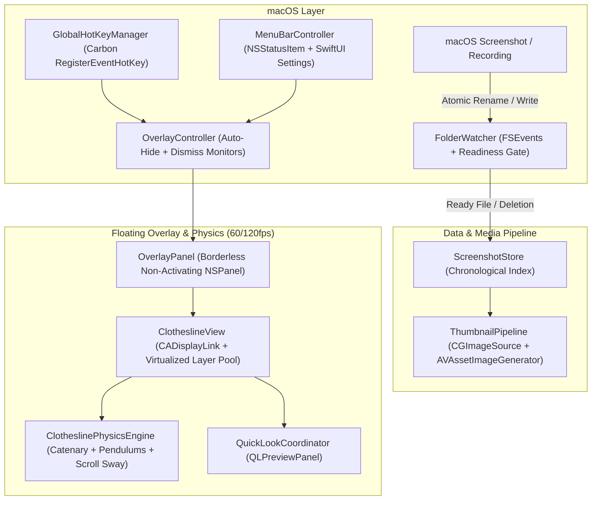

# SnapLine Technical Architecture

SnapLine is built purely with native Apple frameworks (`AppKit`, `QuartzCore`, `SwiftUI`, `AVFoundation`, `QuickLookUI`, `CoreServices`, `Carbon`) with **zero external dependencies** and **zero WebView/Electron overhead**.

---

## System Overview

---

## Core Subsystems

### 1. `FolderWatcher` & Readiness Gate (`Sources/SnapLineCore/Core/FolderWatcher.swift`)
- **Low-latency Monitoring:** Uses `FSEventStreamCreate` (`kFSEventStreamCreateFlagFileEvents | kFSEventStreamCreateFlagNoDefer`, latency `0.015s`) paired with a directory vnode `DispatchSource` and `NSWorkspace.didMountNotification` for external volumes.
- **Readiness Gate:**
  - Ignores hidden dotfiles (such as macOS's `.Screenshot...png` staging files) and subdirectories.
  - For images: checks on attempt 0 whether `fileSize > 0` and `CGImageSourceGetStatusAtIndex(source, 0) == .statusComplete` with valid pixel dimensions (typically ready within `~15ms` after atomic rename); falls back to `40ms` polling if still flushing.
  - For videos (`.mov`, `.mp4`, `.m4v`): waits for size stability and `AVURLAsset` readiness (`isPlayable && duration > 0`) before triggering.

### 2. `ClotheslinePhysicsEngine` (`Sources/SnapLineCore/Physics/ClotheslinePhysicsEngine.swift`)
A pure, AppKit-independent physics module that drives both rendering and unit tests:
- **Catenary Rope & Traveling Elastic Waves:**
  $$y(x) = y_0 + s \cdot \left(1 - \left(\frac{2x}{W} - 1\right)^2\right) + \sum_k A_k e^{-\gamma t_k}\sin(\omega t_k)\exp\!\left(-\frac{(x - x_k)^2}{2\sigma^2}\right)$$
- **Damped Pendulums:** Each card pivots around its clothespin jaw `(0.5, 2pt/H)` using semi-implicit Euler integration ($\omega_0 = 8.2$, $\zeta = 0.24$ idle / $0.58$ hovered).
- **Cohesive Scroll Sway:** Trackpad gestures track 1:1 (`applyDirectScrollDelta`) without synthetic velocity compounding; smoothed horizontal velocity drives a subtle shared lean (`scrollSwayAngle` clamped to `±0.085 rad`) so cards never jitter or overlap while scrolling rapidly.
- **4-Stage Choreography (`triggerNewCapture`):**
  1. `0.00s`: Curtain drops from top + gentle breeze impulse makes visible cards sway.
  2. `0.16s`: Existing cards hold their visual slot briefly, then spring-slide left by `slotSpacing`.
  3. `0.22s`: New card arcs up from bottom-right along a quadratic Bezier path (`scale: 0.52 → 1.0`).
  4. `0.60s`: Clothespin snaps shut (`pinSnapProgress: 0 → 1` with overshoot), inducing an elastic wave on the rope and sympathetic impulses on neighboring cards.
- **Demand-Driven `CADisplayLink`:** `step(dt:)` returns `false` once all springs, waves, and scroll offsets converge, allowing `ClotheslineView` to set `displayLink.isPaused = true` for **~0% idle CPU**.

### 3. Virtualized `CALayer` Rendering (`Rendering/` & `UI/ClotheslineView.swift`)
- **Single-Flip Root Geometry:** Only the root `NSView` backing layer sets `isGeometryFlipped = true`; all child layers remain unflipped relative to parent to prevent cumulative coordinate inversion.
- **Zero Implicit Ghosting:** Every layer sets `actions = NSNull()` across all animatable keys and `PolaroidCardLayer.action(forKey:)` returns `nil`. Frame updates wrap in a single `CATransaction` with `setDisableActions(true)`, dirty-checking hover shadows and clothespin offsets.
- **O(1) Virtualization + Prefetching:** `visibleIndexRange(buffer: 2)` mounts only on-screen cards (`~10–14` layers even with thousands of screenshots), while `buffer: 6` prefetches thumbnails ahead of scroll and `buffer: 8` guards against premature cancellation.
- **Procedural Retina `@2x` Assets (`ProceduralAssets.swift`):** Braided jute twine tiles, beechwood clothespins with coiled metal springs, and Menu Bar template icons are rendered once at startup via CoreGraphics — zero external image assets required.

### 4. `ThumbnailPipeline` (`Sources/SnapLineCore/Core/ThumbnailPipeline.swift`)
- Two-tier cache: in-memory `NSCache` (limit `160` items / `48 MB`) + JPEG disk cache under `~/Library/Caches/com.snapline.app/thumbnails` (capped around 260–340 files).
- Bounded concurrency (max `6` tasks) with `CGImageSourceCreateThumbnailAtIndex` (`maxPixelSize: 380`) and `AVAssetImageGenerator`, plus automatic task cancellation when cards scroll far off-screen.
